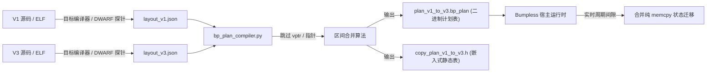

# Bumpless

> **Function-Granularity Real-Time Online Hot-Update Engine**  
> 专为工控实时系统、运动控制器与高实时嵌入式系统设计的无扰（Bumpless）在线热更新引擎。

[](#)
[](#)
[](#)

---

## 概述

在工业自动化（PLC）、机器人控制以及低时延嵌入式系统中，控制逻辑或状态变量的变更通常需要停机烧录。传统在线修改（Online Change）常面临两难困境：
1. **代码级热补丁（Dynamic Binary Patching）**：侵入性极强，严重依赖特定 CPU 指令集架构，且难以安全迁移状态变量；
2. **运行时自省反射（Runtime Reflection）**：在动态库中携带大量字段名称、类型等元数据字符串，导致实时固件体积膨胀，且在周期切换时进行动态匹配会引发不可预测的时延抖动（Jitter）。

**Bumpless** 提出了**“转发表函数切换 + 离线探针/DWARF 静态反射 + 预编译 CopyPlan 合并拷贝”**架构：
* **裸 POD 零膨胀**：固件与动态库仅包含标准 C/C++ 裸数据结构，运行时二进制不含任何字符串反射表与元数据。
* **脏活离线预处理**：版本间的类型比对、偏移推导、安全过滤与内存区间合并全部在离线后台完成。
* **实时周期严格确定**：在微秒级的实时周期间隙仅执行预合并的纯 `memcpy`，无动态内存分配，无哈希检索，执行耗时严格可预测。
* **C++ 虚表与指针安全隔离**：明确跳过 `vptr`（虚函数表指针）和内部自引用指针，彻底杜绝虚表悬挂与野指针崩溃。
* **首周期故障秒级回滚**：基于异常守护（VEH / sigaction）监控新版本首周期的执行状态，遇非法访问自动原子回退。

---

## 目录结构

```text
bumpless/
├── include/                   # 公共 API 与核心头文件
│   ├── bumpless.h             # 跨平台核心热更引擎（单头文件库设计）
│   ├── common_ids.h           # 统一函数槽与实例槽 ID 常量定义
│   ├── bp_module.h            # 开发者零样板宏助手 (BP_EXPORT_MODULE)
│   └── bp_stubs.h             # 方案1自动生成的原生 C 语法包装桩
├── src/                       # 源代码实现
│   ├── host/
│   │   └── host_main.c        # 运行时宿主（调度 RT 周期、加载模块与 Plan）
│   └── modules/               # 可热更功能块（POU / FB）模块源码
│       ├── fn_main.c          # 顶层 MAIN 主控程序
│       ├── fn_motor_v1.c      # 电机控制 FB V1（基础版本）
│       ├── fn_motor_v2_logic.c# 电机控制 FB V2（纯逻辑修改，0 拷贝快速路径）
│       ├── fn_motor_v3_layout.c# 电机控制 FB V3（布局变更，新增温度与重排字段）
│       └── fn_motor_v4_crash.c# 电机控制 FB V4（故障注入，验证崩溃守护与回滚）
├── tools/                     # 离线探测、反射与 CopyPlan 预编译工具链
│   ├── bp_probe.h             # 目标 ABI 同构宏与元数据结构体
│   ├── probe_motor.c          # 目标同构探针源码（用目标编译器编译）
│   ├── bp_dwarf_probe.py      # 离线 DWARF 零侵入布局提取器
│   ├── bp_plan_compiler.py    # 离线 CopyPlan 编译器（区间合并与安全过滤）
│   └── bp_stub_gen.py         # 方案1透明包装桩生成器与模块脚手架工具
├── docs/                      # 架构设计、核心原理与技术权衡文档
│   ├── ARCHITECTURE.md        # 详细原理分析、设计公式、优缺点与边界条件
│   └── WHY_NOT_STACK_ALLOCATION.md # 深度技术规范：为什么热更状态绝不能选栈分配？
├── build/                     # 构建产物输出目录（可由 make clean 清理）
└── Makefile                   # 统一自动化构建系统
```

---

## 快速开始

### 依赖环境
* **C 编译器**：支持 C11 标准的 GCC、Clang 或 MSVC
* **Python**：Python 3.8+（用于运行离线 CopyPlan 编译器与 DWARF 解析工具）
* **GNU Make**

### 构建与运行
```bash
# 1. 一键编译所有模块、提取离线 ABI 布局、生成 CopyPlan 并启动宿主验证
make run

# 2. 清理所有编译生成目录与二进制文件
make clean
```

---

## 离线工具链工作流



---

## 非周期系统与航天/通用 C 程序的适用边界

> [!IMPORTANT]
> **核心前置条件（Prerequisite）**：Bumpless 的无扰热更新依赖**“静默点（Quiescent Point）”**语义——即在执行指针切换与内存拷贝的瞬间，**目标功能块的函数绝不能正处于任何线程的调用栈激活状态中（Active on Call Stack）**。

* **周期性系统（如 PLC / 运动控制）—— 天然安全**：
  PLC 采用严格的循环扫描模型（输入采样 -> 逻辑执行 -> 输出刷新 -> **周期间隙静止点**）。在周期间隙，所有 POU 函数均已返回退出，调用栈处于完全清空状态，天然具备静默点。
* **非周期 / 事件驱动 / 航天嵌入式系统的适配要求**：
  若在通用非周期 C 程序（如基于消息队列的事件循环、NASA cFS 模式、多线程异步任务）中使用，必须通过以下模式之一保障静默点：
  1. **事务边界检查点（Transaction Checkpoint）**：在处理完一次离散事件/指令报文后的空闲状态（Idle Loop）调用迁移，不可在事件处理中途替换；
  2. **协作式活动计数器（Execution Drain）**：在调用入口与出口增减原子计数器，热更管理线程等待活跃调用归零后方可执行内存迁移；
  3. **延迟安全回收（RCU / Grace Period）**：旧动态库和旧内存不能在第一周期立即卸载，须等待所有并发执行流退出旧代码段。
* **明确不支持的场景**：
  如果函数内部包含**长时阻塞调用（Blocking I/O）、休眠死循环（`while(1) { sleep(); }`）或无法退栈的深层递归**，且外部无法找到栈排空时刻，则**严禁在此类函数运行期间强制执行结构体变动（Layout Migration）**。

关于系统设计思想、确定性数学模型、C++ 虚表防护机制以及非周期静默点深度设计，请参阅 [docs/ARCHITECTURE.md](docs/ARCHITECTURE.md)。

---

## 许可证

本项目基于 [MIT License](LICENSE) 开源。
