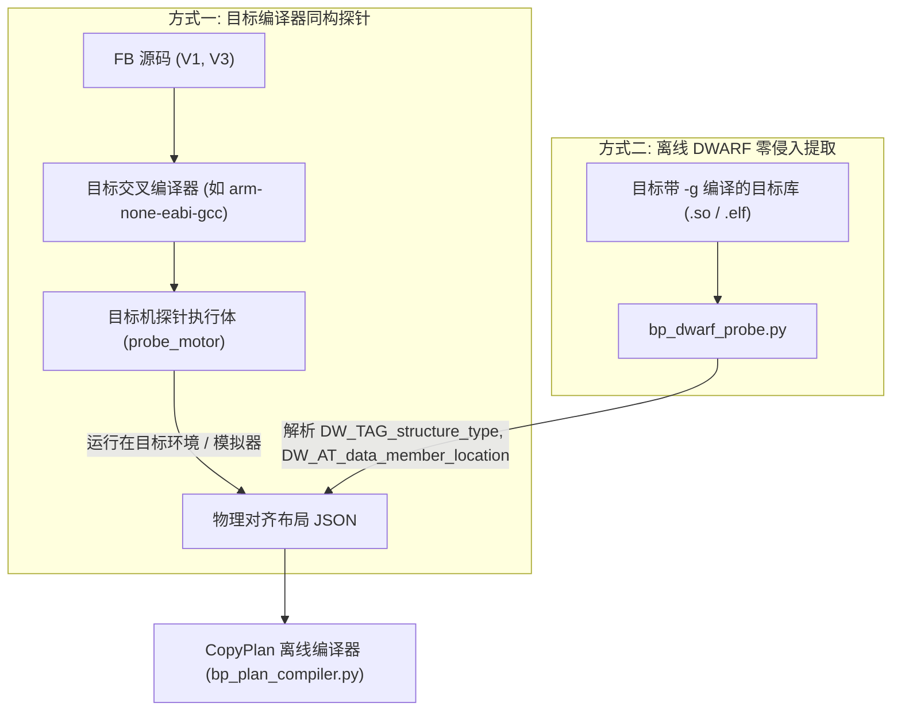

# Bumpless 系统架构与核心技术规格书

本文档系统性阐述 Bumpless 热更新引擎的设计思想、核心原理、数学模型、安全隔离机制以及与其他在线修改方案的深度优缺点对比。

---

## 目录
- [一、 背景与设计动机](#一-背景与设计动机)
- [二、 核心设计原理与概念](#二-核心设计原理与概念)
  - [1. 函数转发表与扁平实例槽池](#1-函数转发表与扁平实例槽池)
  - [2. 裸 POD 零膨胀理念](#2-裸-pod-零膨胀理念)
  - [3. 目标机 ABI 同构探针机制](#3-目标机-abi-同构探针机制)
  - [4. vptr 与内部指针的安全隔离机制](#4-vptr-与内部指针的安全隔离机制)
  - [5. 预编译 CopyPlan 与连续内存区间合并](#5-预编译-copyplan-与连续内存区间合并)
  - [6. 确定性实时周期间隙保障模型](#6-确定性实时周期间隙保障模型)
  - [7. 首周期崩溃守护与原子回滚](#7-首周期崩溃守护与原子回滚)
- [三、 方案优缺点与技术权衡 (Trade-offs)](#三-方案优缺点与技术权衡-trade-offs)
  - [1. 核心优势 (Pros)](#1-核心优势-pros)
  - [2. 固有局限与边界条件 (Cons & Limitations)](#2-固有局限与边界条件-cons--limitations)
- [四、 竞品架构对比](#四-竞品架构对比)

---

## 一、 背景与设计动机

在现代工业自动化（PLC）、高精度运动控制系统、机器人及边缘实时控制节点中，系统通常以固定的周期时钟（如 250 µs、500 µs 或 1 ms）循环执行采样、计算与输出。当业务工艺需要调整或修复 Bug 时，传统的停机更新往往导致整条生产线停摆，带来巨大经济损失。

传统的在线修改（Online Change）存在以下致命缺陷：
1. **指令级二进制热补丁（Dynamic Binary Patching）**：直接在内存中向旧函数头部写入跳板指令（JMP Trampoline）。该方式对 CPU 指令缓存（I-Cache）、多核可见性及特定架构依赖极深，极易引发竞态冒险，且无法解决结构体增删字段导致的内存重排问题。
2. **运行时元数据自省（Runtime Reflection）**：在动态库中携带类型反射字符串表（字段名、数据类型等）。这不仅使受限嵌入式固件的体积严重膨胀，更致命的是，在纳秒至微秒级的实时周期间隙中进行字符串比对与动态寻址，会引入不可接受且不可预测的**时延抖动（Jitter）**。

Bumpless 由此提出：**脏活在离线与非实时后台彻底算完，实时周期间隙只执行纯粹的硬件级合并 `memcpy`**。

---

## 二、 核心设计原理与概念

### 1. 函数转发表与扁平实例槽池

系统将传统 C/C++ 的直接符号调用或类成员函数指针调用解耦为两张核心间接表：
* **函数转发表（Function Dispatch Table, `g_fn_table[fn_id]`）**：全局统一的函数指针数组，每个热更函数对应一个固定槽位。
* **扁平实例槽池（Flat Instance Slot Pool, `g_inst_table[inst_id]`）**：全局维护的实例指针数组。

```
[MAIN POU] ---> BP_CALL(ctx, FN_FB_MOTOR, s->motor1_inst_id, now_ns)
                     │
                     ├──> g_fn_table[FN_FB_MOTOR]   ──> motor_exec(...)
                     └──> g_inst_table[INST_MOTOR1] ──> void* self (实例内存)
```

**级联解耦优势**：
父级 POU（如 `MAIN`）内部仅持有子级 FB 的实例槽 ID（`uint32_t motor1_inst_id`），而非直接按值内嵌子结构体。当子 FB 发生结构体布局扩展时，**仅需重构子 FB 对应的槽位内存，顶层 `MAIN` 代码完全不需要重新编译**。

---

### 2. 裸 POD 零膨胀理念

在工业生产固件中，控制块的状态变量通常定义为标准 Plain Old Data (POD) 结构体：
```c
typedef struct {
    int32_t speed;
    int32_t torque;
    bool    running;
} FbMotor;
```
* **传统做法**：在编译产物内硬编码 `BpFieldLeaf` 数组、字符常量 `"speed"`、`"torque"`，并导出获取反射表的动态函数。
* **Bumpless 裸 POD 设计**：
  * 运行时模块导出的 `BpModuleABI` 中，`get_fields` 显式设为 `NULL`；
  * 二进制文件内无任何字段描述字符串，数据段零冗余；
  * 状态结构体保持天然连续布局，保持绝对的零体积与零符号膨胀。

---

### 3. 目标机 ABI 同构探针机制

结构体的物理内存偏移不仅取决于字段顺序，还受**目标编译器架构、字长（32-bit vs 64-bit）、对齐规则（Natural Alignment）、尾部填充（Padding）及字节序（Endianness）**的决定性影响。

若在 x86_64 宿主机上直接运行脚本计算布局，而目标机为 32 位的 ARM Cortex-M，二者的偏移和虚表指针长度截然不同，盲目拷贝会导致数据完全错位甚至硬件 HardFault。

Bumpless 建立了**目标机 ABI 同构探测体系**：



* **方案 A（同构编译器探针）**：使用与固件完全一致的交叉工具链编译轻量级探针，通过 `offsetof` 与 `sizeof` 直接获取目标硬件运行时的真实字节偏移。
* **方案 B（离线 DWARF 解析器）**：针对生产环境，直接从编译器生成的调试段（DWARF 3/4/5）提取 DIE 属性（`DW_AT_data_member_location`），**不改变哪怕一行源码**即可完成物理布局重建。

---

### 4. vptr 与内部指针的安全隔离机制

在面向对象或含虚函数表的高级工控组件中，盲目浅拷贝会导致致命的内存悬挂。Bumpless 实现了严格的指针安全隔离过滤器：

```
       旧实例内存 (Old Memory)                       新实例内存 (New Memory)
┌────────────────────────────────┐            ┌────────────────────────────────┐
│  temperature (未定义)           │            │  temperature = 30.0f           │ (新分配初值)
├────────────────────────────────┤            ├────────────────────────────────┤
│  speed = 220                   │ ──memcpy─> │  speed = 220                   │ (状态平滑继承)
├────────────────────────────────┤            ├────────────────────────────────┤
│  torque = 26                   │ ──memcpy─> │  torque = 26                   │ (状态平滑继承)
├────────────────────────────────┤            ├────────────────────────────────┤
│  running = 1                   │ ──memcpy─> │  running = 1                   │ (状态平滑继承)
├────────────────────────────────┤            ├────────────────────────────────┤
│  calc_vfn (指向旧模块 vtable)   │ ─ [跳过!] ─ │  calc_vfn (指向新模块 vtable)   │ (保留有效新虚表)
├────────────────────────────────┤            ├────────────────────────────────┤
│  active_tag (指向旧内存 tag_buf)│ ─ [跳过!] ─ │  active_tag (指向新内存 tag_buf)│ (保留新内锚指针)
├────────────────────────────────┤            ├────────────────────────────────┤
│  tag_buf = "TAG_V1"            │ ──memcpy─> │  tag_buf = "TAG_V1"            │ (内容复制)
└────────────────────────────────┘            └────────────────────────────────┘
```

#### 4.1 跳过 `vptr`（虚表指针）
* **隐患剖析**：新实例在创建时执行构造函数（`init_inst`），其内部已正确填入了新加载动态库代码段的 vtable 地址。若在状态迁移阶段执行全对象覆盖，新对象的 `vptr` 将被篡改为旧模块的 vtable。当旧模块存活校验通过并被宿主 `dlclose` / `FreeLibrary` 卸载后，该地址成为未映射野指针，后续虚方法调用将引发**不可逆段错误（SIGSEGV / Access Violation）**。
* **防御机制**：离线编译器主动识别标记为 `BP_FLAG_IS_VPTR`、类型为 `BP_TYPE_VPTR` 或名称匹配虚表特征（`_vptr`、`vtable`）的字段，从 CopyPlan 复制列表中**物理剔除**。

#### 4.2 跳过内部自引用指针（Internal Pointers）
* **隐患剖析**：若结构体内含有指向自身内部缓冲区的指针（如 `self->active_tag = &self->tag_buf[0]`），执行浅拷贝后，新实例的指针仍指向已被回收的旧实例内存。在旧内存被释放后，任何针对该指针的写操作都会破坏堆内存。
* **防御机制**：离线编译器识别出指针类型字段并将其排除，新实例的指针由其构造函数（或初始化钩子）直接重新锚定到新实例的内存空间。

---

### 5. 预编译 CopyPlan 与连续内存区间合并

如果按字段逐个调用复制，10 个字段就会触发 10 次调用开销。Bumpless 采用**区间合并算法（Interval Coalescing）**：

在离线编译期，比对旧版本和新版本的匹配字段，按目的端偏移排序后，检测相邻区间的物理连续性：
$$\text{src\_off}_{k-1} + \text{len}_{k-1} == \text{src\_off}_k \quad \land \quad \text{dst\_off}_{k-1} + \text{len}_{k-1} == \text{dst\_off}_k$$
若条件成立，则将两操作合并为一个连续区间，长度累加。

**示例**：
* 原始字段：`speed(4B)` + `torque(4B)` + `running(1B)`
* 传统方案：执行 3 次拷贝，开销较大。
* Bumpless 方案：自动收敛为单次连续拷贝：`memcpy(dst + 4, src + 0, 9)`。

输出结果被序列化为二进制 `.bp_plan`（供支持文件系统的控制器动态下发），或直接导出为静态 C 结构头文件（供完全无文件系统的 Bare-metal 裸机环境使用）。

---

### 6. 确定性实时周期间隙保障模型

为了保证实时控制循环不丢周期，Bumpless 将所有耗时操作前移：
* **非实时管理线程（离线/后台）**：完成动态库装载、符号解析、Plan 读取、新实例内存分配与初始化校验、内存拷贝预算审核；
* **实时扫描线程（周期切换瞬态）**：仅在两个周期间的静止期（Quiescent Point）原子执行预编译操作。

切换时间上限可严格形式化量化：
$$T_{\text{gap}} = T_{\text{atomic\_swap}} + \sum_{m=1}^{M} \left( \sum_{k=1}^{K} T_{\text{call}}(\text{memcpy}) + \frac{\text{Bytes}_k}{\text{Bandwidth}_{\text{RAM}}} \right) \le T_{\text{budget}}$$

其中：
* $M$ 为当前热更 FB 拥有的实例总数；
* $K$ 为合并后的操作条目数（远小于原始字段数）；
* $T_{\text{budget}}$ 为预设的安全预算阈值（超出时管理线程直接拒绝热更，避免侵入实时周期）。

---

### 7. 首周期崩溃守护与原子回滚

任何热更新都存在逻辑缺陷导致崩溃的潜在风险。Bumpless 集成了首周期崩溃守护（基于 POSIX `sigaction` + `sigsetjmp`，以及 Windows 平台下的 Vectored Exception Handler）：

```
[RT Cycle 执行]
       │
       ├─ (无异常) ──> 首周期存活 ──> 永久提交新版本，安全释放旧版本动态库与内存
       │
       └─ (捕获非法访问 0xC0000005 / SIGSEGV)
              │
              ├── 拦截异常，阻止进程崩溃退出
              ├── 原子复原 g_fn_table 指向已知良好的旧版本函数
              ├── 原子复原 g_inst_table 挂回旧版本实例内存
              └── 立即在当前周期无缝重新调度旧逻辑，保障工业现场控制连续
```

---

## 三、 方案优缺点与技术权衡 (Trade-offs)

### 1. 核心优势 (Pros)

1. **绝对的裸 POD 零膨胀**：
   目标动态库无反射字典、无字符串段，生成的固件极度紧凑，满足严苛的微控制器存储限制。
2. **微秒级确定性时延**：
   周期间隙完全消除动态匹配和动态内存分配，仅包含有限次数的物理内存块拷贝，时间确定。
3. **C++ 混合多态安全**：
   首创性地跳过 `vptr` 与内部指针，使热更新技术首次能安全应用于现代 C++ 工控框架及自包含数据块。
4. **编译期消化繁重开销**：
   所有符号提取、类型一致性检查与 DWARF 分析均移至构建端或非实时后台，不占用现场控制器计算资源。
5. **极高的架构可移植性**：
   纯 C11 标准实现，无特定 CPU 指令集架构依赖，不依赖特定汇编指令替换，兼容 Linux PREEMPT_RT、Windows、QNX 及各类 RTOS。

---

### 2. 固有局限与边界条件 (Cons & Limitations)

1. **同构探测工具链依赖**：
   离线探针必须与目标固件使用同版本编译器及相同编译选项。若探针在不同字长、不同字节序的主机运行，必须配合交叉编译探针或 DWARF 静态分析，否则推导出的偏移无效。
2. **深层指针图结构（Deep Pointer Graph）受限**：
   本方案专注于工控平坦数据块与 POD 状态迁移。若实例内部包含深层堆分配（如动态链表、树、外部句柄），直接浅拷贝无法完成深拷贝，必须配合专门的自定义序列化 Hook。
3. **瞬态双倍内存占用**：
   在热更新提交的首个验证周期内，新旧两份实例内存需同时驻留，直至首周期安全存活后才回收旧内存。若控制器极端受限（RAM 空闲率低于单 FB 实例集大小），需进行分批次分槽位热更。（深入解析详见专项技术规格书：[WHY_NOT_STACK_ALLOCATION.md](WHY_NOT_STACK_ALLOCATION.md)）
### 4. 统一签名与调用侵入约束
* **原有约束**：所有可热更 POU/FB 必须遵循统一的转发表函数签名 `void (*BpPouFn)(BpRuntimeCtx* ctx, void* self, uint64_t now_ns)`，宿主必须通过 `BP_CALL` 或 `fn_table[fn_id]` 间接调用。
* **解耦演进**：对于希望直接使用普通 C 调用语法（`motor_exec(&m)`）的存量系统，可通过后文详述的**透明桩（Wrapper Stubs）**或**动态链接符号表劫持（GOT/IAT Hooking）**进行无感抹平。

---

## 四、 宿主调用模式演进：从显式转发表到无感直调 (Call Convention Evolution)

针对**“宿主必须以函数表形式调用”**的侵入性问题，系统支持从“显式转发表”向“无感直调”平滑演进：

### 演进路线对比

| 方案 | 语法侵入性 | 运行期开销 | 平台移植性 | 状态迁移兼容性 | 典型应用场景 |
| :--- | :--- | :--- | :--- | :--- | :--- |
| **方案 A：显式转发表 (当前默认)** | 需要使用 `BP_CALL` | 极低（1次指针解引用） | 100% 标准 C11 | 完美配合实例槽池 | PLC 虚拟机、ST 编译器生成代码 |
| **方案 B：透明内联桩 (Wrapper Stubs)** | **零侵入（原生 C 语法）** | 极低（可内联） | 100% 标准 C11 | 完美配合实例槽池 | 现代 C/C++ 业务层无感集成 |
| **方案 C：GOT / IAT 符号重定向** | **零侵入（原生动态库调用）**| 零额外开销 | 依赖 ELF/PE 格式 | 需配合槽位重定位 | 模块化 Linux/Windows 宿主 |
| **方案 D：指令跳板 (JMP Trampoline)** | **零侵入（直接机器码调用）**| 存在跳板开销 | 强依赖 CPU 指令集与 I-Cache | 极难处理布局变更 | Linux 内核 livepatch、只改逻辑的补丁 |

#### 1. 方案 B 实现：透明内联包装桩（已落地实现工具链）

通过工具链自动生成轻量级头文件，宿主和调用方完全通过原生 C 函数语法直调：
* **生成工具**：`tools/bp_stub_gen.py generate --header include/common_ids.h --out include/bp_stubs.h`
* **生成的头文件 (`include/bp_stubs.h`)**：
  ```c
  /* 自动生成的原生 C 直调内联桩 */
  static inline void fb_motor_call(BpRuntimeCtx* ctx, uint32_t inst_id, uint64_t now_ns) {
      BP_CALL(ctx, FN_FB_MOTOR, inst_id, now_ns);
  }
  static inline void fb_motor_call_direct(BpRuntimeCtx* ctx, void* self, uint64_t now_ns) {
      ctx->fn_table[FN_FB_MOTOR](ctx, self, now_ns);
  }
  ```
* **调用方业务代码（如 `src/modules/fn_main.c`）**：
  ```c
  #include "bp_stubs.h"

  static void main_exec(BpRuntimeCtx* ctx, void* self, uint64_t now_ns) {
      MainState* s = (MainState*)self;
      s->cycle_count++;
      
      /* 方案 1: 原生 C 函数直调语法，彻底告别手写 BP_CALL 样板代码 */
      fb_motor_call(ctx, s->motor1_inst_id, now_ns);
  }
  ```
* **模块声明宏 (`include/bp_module.h`)**：
  新模块或迁移存量函数无需手写 30 行 `BpModuleABI` 结构体：
  ```c
  #include "bp_module.h"

  /* 一行宏搞定 ABI 绑定、哈希声明与导出函数 */
  BP_EXPORT_MODULE(
      FN_FB_MOTOR,
      "fn_motor_v1",
      0xA0000001ULL,
      FbMotor_v1,
      motor_init,
      motor_exec
  );
  ```
* **一键脚手架 (`tools/bp_stub_gen.py scaffold`)**：
  ```bash
  python tools/bp_stub_gen.py scaffold --name fn_pid --fn-id FN_FB_PID --struct FbPid --out src/modules/fn_pid.c
  ```
  自动生成符合规范的裸 POD 状态块与生命周期模板，极大降低工程师迁移存量函数的门槛。

#### 2. 方案 C 实现：动态链接器重定向（GOT 劫持）
在 Linux ELF 或 Windows PE 动态库架构中，模块间的函数调用本就通过全局偏移表（GOT, Global Offset Table）或导入地址表（IAT, Import Address Table）完成间接寻址：
* 编译期：`MAIN` 声明 `extern void motor_exec(void* self);`，生成 `call *motor_exec@GOTPCREL`；
* 热更周期间隙：宿主后台不仅挂载新 `.so`，且直接原子替换 `MAIN` 的 GOT 表项：
  ```c
  /* 周期间隙原子修改 GOT 表指针，纳秒级生效 */
  *(void**)got_motor_exec_entry = new_module_motor_exec;
  ```
* **效果**：调用方代码**完全不需要函数表包装，按纯原生 C 动态库接口调用**。

---

## 五、 竞品架构对比

| 评估维度 | 传统二进制热补丁 (Patching) | 运行时自省反射库 (Dynamic) | Bumpless 离线探针/预编译 Plan 方案 |
| :--- | :--- | :--- | :--- |
| **POD 结构体体积** | 零膨胀 | 极度膨胀（大量元数据字符串） | **裸 POD 零膨胀（完全无额外字段）** |
| **结构体布局扩展** | 几乎不可能（容易破坏内存布局） | 支持，但需在实时期动态解析 | **原生支持（解耦槽池 + 预编译 Plan）** |
| **周期间隙时间复杂度**| $O(1)$（仅打跳板） | $O(N \log N)$（动态匹配匹配字段）| **$O(K)$（仅执行少量合并纯 memcpy）** |
| **时延抖动 (Jitter)**| 极小 | 极大且不可预测 | **严格微秒级有界 ($T \le \text{Budget}$)** |
| **C++ 虚表 (vptr) 安全**| 易引发虚表野指针 | 盲目深拷贝引发崩溃 | **明确排除 vptr，自动保留新类虚表** |
| **故障自动回滚** | 极度复杂（需撤销机器码修改）| 难以保证回滚原子性 | **第一周期硬件异常拦截秒级回滚** |
| **硬件跨平台移植性** | 弱（强依赖特定 CPU 指令） | 中等 | **强（纯标准 C11，无平台汇编注入）** |
